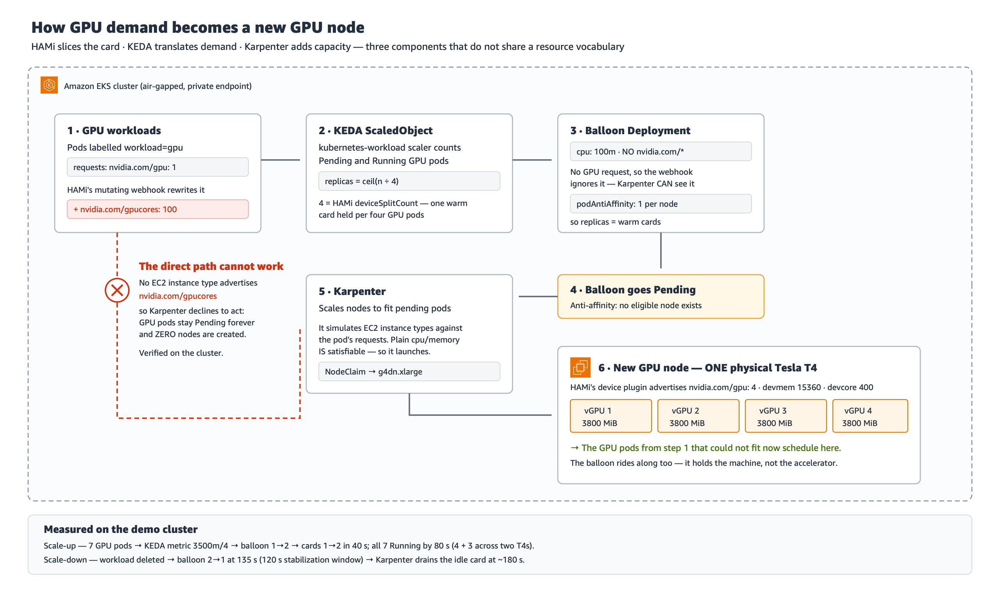
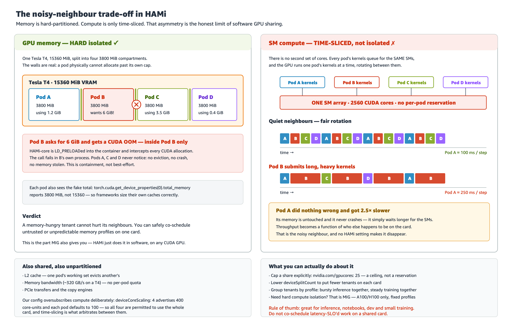

# GPU Sharing and Autoscaling on Amazon EKS with HAMi, KEDA and Karpenter

Run **multiple isolated workloads on a single GPU** on Amazon EKS, and **autoscale the
GPU fleet on demand** — on commodity GPUs such as the NVIDIA T4, in a fully
air-gapped VPC.

Kubernetes allocates GPUs whole: `nvidia.com/gpu` is an integer, so a notebook using
2 GB of a 16 GB card holds the entire card. This sample deploys a working pattern that
fixes both the granularity problem and the scaling problem:

| Component | Role |
|---|---|
| **[HAMi](https://github.com/Project-HAMi/HAMi)** (CNCF Sandbox) | splits one physical GPU into isolated vGPUs with a hard per-pod memory ceiling |
| **[Karpenter](https://karpenter.sh)** | provisions and consolidates GPU nodes to fit pending pods |
| **[KEDA](https://keda.sh)** | translates GPU demand into a signal Karpenter can act on |

**Measured on this sample:** 4 concurrent PyTorch training jobs on one Tesla T4, each
hard-capped at 3800 MiB; 7 workloads served by 2 cards instead of 7; idle cards
auto-consolidated in ~3 minutes.



> [!IMPORTANT]
> **This sample creates billable AWS resources**, including an EKS cluster, GPU EC2
> instances (`g4dn.xlarge`), NAT-free VPC interface endpoints, and ECR repositories.
> Expect roughly **US$0.90/hour for the baseline** plus **~US$0.53/hour per GPU node**
> in `us-east-1` (on-demand, prices vary by region — see
> [EKS pricing](https://aws.amazon.com/eks/pricing/) and
> [EC2 pricing](https://aws.amazon.com/ec2/pricing/)). Follow
> [Cleanup](#cleanup) when you are done.

---

## Table of contents

- [Architecture](#architecture)
- [What makes this non-obvious](#what-makes-this-non-obvious)
- [Prerequisites](#prerequisites)
- [Quick start](#quick-start)
- [Walkthrough 1 — four workloads on one GPU](#walkthrough-1--four-workloads-on-one-gpu)
- [Walkthrough 2 — autoscaling the GPU fleet](#walkthrough-2--autoscaling-the-gpu-fleet)
- [Repository layout](#repository-layout)
- [Configuration](#configuration)
- [Cleanup](#cleanup)
- [Limitations and trade-offs](#limitations-and-trade-offs)
- [Troubleshooting](#troubleshooting)
- [Security](#security)
- [License](#license)

---

## Architecture

The CDK stack builds a **fully air-gapped** EKS 1.36 cluster:

- **No internet gateway and no NAT gateway.** Isolated subnets only.
- **Private-only EKS API endpoint**, reached through an SSM port-forward from a
  bastion (no inbound ports, no bastion key pair).
- **13 VPC endpoints** (12 interface + S3 gateway), including the Lambda endpoint that
  CDK's in-VPC kubectl/Helm provider requires.
- **All container images mirrored into ECR** with `crane`; Helm charts uploaded as CDK
  assets because the public chart repos are unreachable from inside the VPC.

GPU capacity is owned entirely by Karpenter — there is no static GPU node group.

## What makes this non-obvious

Two findings are the reason this sample exists. Both are covered in
[docs/03-how-it-works.md](docs/03-how-it-works.md).

**1. `deviceSplitCount` alone does not share a GPU.** A pod requesting only
`nvidia.com/gpu: 1` receives the card's *entire* memory (`defaultMemory: 0`) and all
100 SM core units (`defaultCores: 0`), so the second pod fails with
`CardInsufficientMemory`, then `CardInsufficientCore`. Three settings are needed
together — see [Configuration](#configuration).

**2. Karpenter cannot see HAMi GPU pods at all.** HAMi's mutating admission webhook
injects `nvidia.com/gpucores` into every pod that requests a GPU. Karpenter decides
what to launch by simulating nodes from the EC2 instance-type catalogue, which has no
such resource, so it declines and pods stay `Pending` **with zero nodes created**:

```text
karpenter: could not schedule pod  "no instance type has enough resources"
  resources={"nvidia.com/gpu":"1","nvidia.com/gpucores":"100"}
```

The fix is a **headroom (balloon) pod** that requests only CPU and memory — the
webhook ignores it, so Karpenter can schedule it, and because the NodePool only offers
GPU instances, satisfying it means launching a GPU node. KEDA sizes that Deployment
from the count of GPU pods.

## Prerequisites

| Requirement | Notes |
|---|---|
| AWS account with admin-equivalent permissions | Creates VPC, EKS, IAM, ECR resources |
| **GPU service quota** | ≥ 4 vCPU for `Running On-Demand G and VT instances` in your region |
| AWS CLI v2 | `aws --version` |
| Session Manager plugin | For the SSM tunnel to the private API endpoint |
| Node.js 18+ and AWS CDK v2 | `npm install -g aws-cdk` |
| **Python ≥ 3.10** | `lambda-layer-kubectl-v36` requires it |
| `kubectl` 1.36.x | Match the cluster version |
| `helm` 3.x | Used to fetch charts |
| [`crane`](https://github.com/google/go-containerregistry/blob/main/cmd/crane/README.md) | Mirrors images into ECR |

Third-party binaries are **not** vendored in this repository — install them yourself.
See [docs/01-prerequisites.md](docs/01-prerequisites.md) for install commands.

## Quick start

```bash
git clone https://github.com/aws-samples/<repo-name>.git
cd <repo-name>

# 1. Python env for CDK (must be 3.10+)
python3 -m venv infra/.venv && . infra/.venv/bin/activate
pip install -r infra/requirements.txt

# 2. Fetch the third-party Helm charts (not vendored — Apache-2.0 upstream)
./scripts/fetch-charts.sh

# 3. Stage 1 — VPC, EKS cluster, ECR repositories (charts disabled)
export AWS_REGION=us-east-1
cd infra && cdk bootstrap && cdk deploy -c enable_keda=false && cd ..

# 4. Mirror all container images into ECR (~5 GB, one time)
./scripts/mirror-images.sh --region "$AWS_REGION"

# 5. Stage 2 — install HAMi, Karpenter and KEDA
cd infra && cdk deploy && cd ..

# 6. Connect to the private cluster (leave running in its own terminal)
./scripts/connect-private.sh
# then, in another terminal:
export KUBECONFIG=/tmp/hami.kube

# 7. Render manifests with your account's values
./scripts/render-manifests.sh
```

> **Why staged?** The ECR repositories must exist and be populated before Helm tries
> to pull the images, otherwise the chart install times out inside the VPC.

Verify the install:

```bash
./scripts/verify-hami.sh
kubectl get ec2nodeclass,nodepool          # both READY=True
kubectl -n kube-system get pods | grep -E "hami|karpenter|keda"
```

Full deployment detail: [docs/02-deploy.md](docs/02-deploy.md).

## Walkthrough 1 — four workloads on one GPU

```bash
kubectl apply -f manifests/rendered/00-priorityclasses.yaml
kubectl apply -f manifests/rendered/01-headroom-pods.yaml   # warms one card (~85 s)

# submit four real PyTorch training jobs
for i in $(seq 4); do kubectl create -f manifests/rendered/02-train-job.yaml; done
kubectl get pods -l app=train -o wide      # 4/4 Running, all on the SAME node
```

The isolation proof — each container sees only its slice:

```bash
kubectl logs -l app=train --tail=5 | grep visible_mem
# GPU=Tesla T4  visible_mem=3800MiB       <- not 15360
```

HAMi-core is `LD_PRELOAD`ed into the container and intercepts the CUDA driver calls,
so even `torch.cuda.get_device_properties(0).total_memory` reports the slice. The job
never requested a limit and cannot exceed it.

## Walkthrough 2 — autoscaling the GPU fleet

```bash
kubectl apply -f manifests/rendered/04-keda-scaledobject.yaml
kubectl apply -f manifests/rendered/03-gpu-load.yaml
kubectl scale deploy gpu-load --replicas=7      # 7 pods vs a 4-slot card

kubectl get hpa keda-hpa-gpu-headroom           # TARGETS 3500m/4
kubectl get nodeclaims                          # a second card appears
kubectl get pods -l workload=gpu -o wide        # 4 on card one, 3 on card two
```

Observed timings on `g4dn.xlarge`:

| Event | Time |
|---|---|
| KEDA reacts, headroom scales 1 → 2 | ~40 s |
| Second node registers | ~85 s |
| All 7 pods Running | ~80 s |
| Headroom returns to 1 after workload deleted | ~135 s |
| Idle card drained by Karpenter | ~180 s |

Scale-in is hands-off — delete the workload and leave KEDA alone:

```bash
kubectl delete deploy gpu-load
```

Do **not** `kubectl scale deploy gpu-buffer` — the KEDA-managed HPA owns that field.

## Repository layout

```
.
├── infra/                       CDK application (Python)
│   ├── app.py                   entry point
│   ├── config.py                all tunables (see Configuration)
│   ├── images.json              images mirrored into ECR
│   ├── stacks/                  the stack definition
│   └── charts/                  populated by scripts/fetch-charts.sh (gitignored)
├── manifests/                   demo workloads, with placeholders
│   ├── 00-priorityclasses.yaml
│   ├── 01-headroom-pods.yaml    the balloon/headroom Deployment
│   ├── 02-train-job.yaml        real PyTorch training job
│   ├── 03-gpu-load.yaml         lightweight scalable GPU load
│   ├── 04-keda-scaledobject.yaml
│   ├── 05-memory-limit-test.yaml
│   ├── 10-karpenter-gpu-pool.yaml
│   └── rendered/                produced by render-manifests.sh (gitignored)
├── scripts/
│   ├── fetch-charts.sh          pull upstream Helm charts
│   ├── mirror-images.sh         crane-copy images into ECR
│   ├── render-manifests.sh      substitute account-specific values
│   ├── connect-private.sh       SSM port-forward to the private API
│   ├── verify-hami.sh           post-install checks
│   └── demo-watch.sh            live status pane (macOS-safe, no `watch`)
└── docs/                        prerequisites, deploy, how-it-works, troubleshooting
```

## Configuration

Everything is in [`infra/config.py`](infra/config.py) and overridable at deploy time
with `cdk deploy -c <key>=<value>`.

| Key | Default | Purpose |
|---|---|---|
| `k8s_version` | `1.36` | EKS version |
| `gpu_instance_type` | `g4dn.xlarge` | Karpenter GPU instance type |
| `gpu_disk_size_gb` | `100` | **Must exceed your largest image**; the AMI default of 20 GB causes pod eviction |
| `hami_device_split_count` | `4` | vGPUs advertised per physical GPU |
| `hami_default_memory_mb` | `3800` | Hard memory ceiling per vGPU — set to `card_memory / split_count` |
| `hami_device_core_scaling` | `4` | Compute oversubscription so N pods fit |
| `enable_karpenter` | `True` | Karpenter controller + GPU NodePool |
| `enable_keda` | `True` | KEDA controller (set `false` for stage 1) |
| `air_gapped` | `True` | No IGW/NAT, private endpoint, ECR mirror |

**The three HAMi settings must stay consistent.** `hami_default_memory_mb` should be
`card_memory ÷ hami_device_split_count` so that running out of vGPU slots and running
out of GPU memory happen at the same time — that alignment is what lets KEDA divide by
a single number. Changing one without the others produces slots that can never be
filled.

For a different GPU, recalculate: an A10G (24 GB) split 4 ways wants
`hami_default_memory_mb ≈ 5900`.

## Cleanup

```bash
# remove demo workloads first
kubectl delete deploy gpu-load gpu-buffer --ignore-not-found
kubectl delete job -l app=train --ignore-not-found
kubectl delete -f manifests/rendered/04-keda-scaledobject.yaml --ignore-not-found

# then destroy the stack
cd infra && cdk destroy
```

> [!WARNING]
> Do **not** `kubectl delete` the `ec2nodeclass` or `nodepool` before `cdk destroy`.
> Their finalizers call the IAM API, which is unreachable from an air-gapped VPC, so
> the objects hang in `Terminating` forever. If that happens:
> `kubectl patch ec2nodeclass gpu --type=merge -p '{"metadata":{"finalizers":null}}'`

ECR repositories and their images are retained by default so a redeploy does not
re-download ~5 GB. Delete them manually if you want a zero-cost teardown. Verify no
GPU instances survive:

```bash
aws ec2 describe-instances --filters "Name=tag-key,Values=karpenter.sh/nodepool" \
  "Name=instance-state-name,Values=running" --query 'Reservations[].Instances[].InstanceId'
```

Detail: [docs/06-cleanup.md](docs/06-cleanup.md).

## Limitations and trade-offs

**Memory is hard-isolated. Compute is not.** This is the central trade-off and you
should understand it before using this pattern in production.



- **Memory** — a hard ceiling. Exceeding it raises a CUDA OOM *inside the offending
  pod*; neighbours are unaffected. Safe to co-schedule unpredictable memory profiles.
- **Compute** — time-sliced only. All pods submit kernels to the same SM array, so a
  neighbour running heavy kernels reduces your throughput. `nvidia.com/gpucores` caps
  a pod's share, but it is a **ceiling, not a reservation**: kernels are not
  preemptible, enforcement is sampled, and L2 cache, memory bandwidth and PCIe remain
  unpartitioned.
- **Suitable for** inference, notebooks, development, CI and small training jobs.
- **Not suitable for** latency-SLO'd workloads on a shared card. Use a dedicated card,
  or MIG on A100/H100 for hardware-enforced compute isolation.

Other constraints:

- Karpenter cannot autoscale on `nvidia.com/gpumem` or `nvidia.com/gpucores` at all —
  HAMi does not publish them as node-allocatable. The headroom-pod indirection is
  required, not stylistic.
- `NodePool.limits.nvidia.com/gpu` counts **vGPUs, not cards**. With
  `deviceSplitCount: 4`, a limit of `4` caps the fleet at one card.
- Single region, single AZ-agnostic NodePool. Not a multi-tenant production reference.
- HAMi is a CNCF **Sandbox** project; evaluate its maturity for your own use case.

## Troubleshooting

| Symptom | Likely cause |
|---|---|
| GPU pods `Pending`, **zero** NodeClaims | Expected without the headroom pod — see [What makes this non-obvious](#what-makes-this-non-obvious) |
| Only one pod schedules per card | `hami_default_memory_mb` / `hami_device_core_scaling` not set |
| `ec2nodeclass` `READY=False`, SG selector matched nothing | Select the cluster SG by ID, not by tag |
| `InstanceProfileReady=Unknown` forever | IAM has no VPC endpoint; the profile must be pre-created |
| Pods `Evicted`, "low on resource: ephemeral-storage" | `gpu_disk_size_gb` too small for your images |
| `kubectl` times out | SSM tunnel not running — re-run `./scripts/connect-private.sh` |
| Pod `Pending` with no Events at all | `hami-scheduler` not running |

Full matrix: [docs/07-troubleshooting.md](docs/07-troubleshooting.md).

## Security

- The cluster has **no inbound internet exposure**: private-only API endpoint, no
  IGW/NAT, and bastion access via SSM Session Manager rather than SSH.
- No credentials are stored in this repository. All manifests use placeholders; real
  values are substituted locally by `scripts/render-manifests.sh` into a gitignored
  directory.
- The CDK stack grants Karpenter broad `ec2:*` for demo simplicity. **Scope this down
  before production use** — see the comment in `infra/stacks/eks_hami_stack.py`.
- Third-party Helm charts and container images are pulled from their upstream
  publishers at setup time and mirrored into your own ECR; nothing third-party is
  vendored here.

See [CONTRIBUTING](CONTRIBUTING.md#security-issue-notifications) for how to report a
security issue. Do not open a public GitHub issue for vulnerabilities.

## License

This library is licensed under the MIT-0 License. See the [LICENSE](LICENSE) file.
